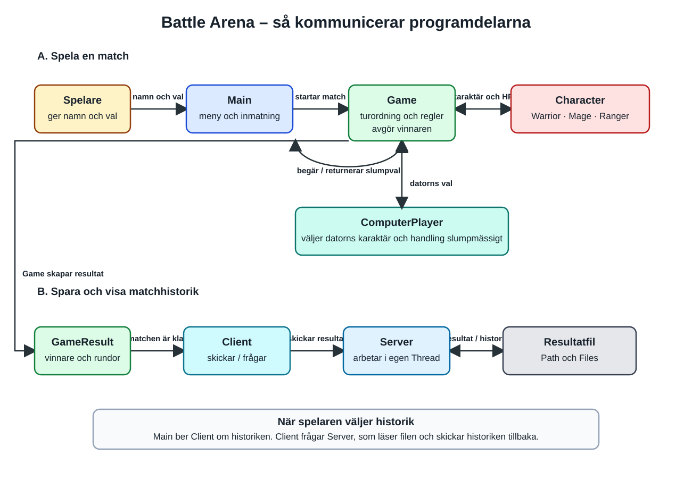
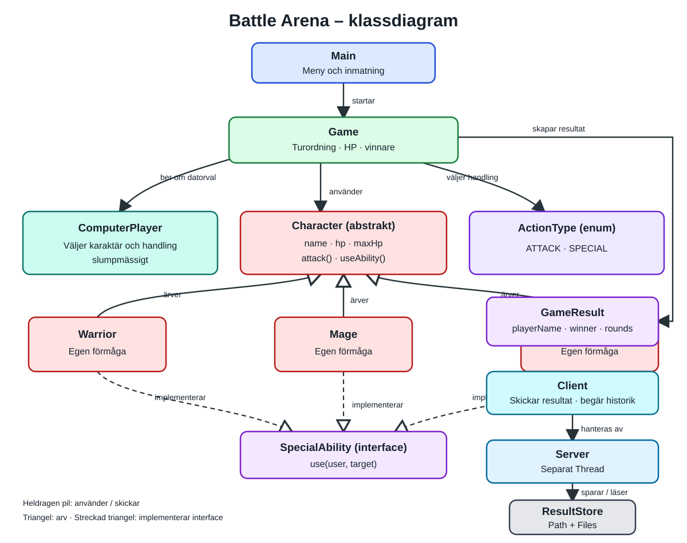
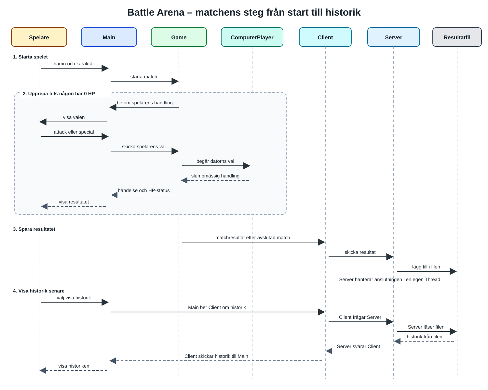

# Battle Arena

Battle Arena är ett turbaserat Java-spel där spelaren väljer en karaktär och möter en datorstyrd motståndare. Spelarna turas om att attackera eller använda en särskild förmåga. Matchen pågår tills en karaktär når 0 HP, och programmets delar samarbetar för att visa matchen och spara resultatet i en historik.

## Kommunikationsdiagram

Diagrammet är uppdelat i två delar: **A** visar spelet och **B** visar hur resultatet sparas och hur historiken hämtas. Rutorna har olika ljusa färger, mörk text och pilar med korta etiketter på vit bakgrund.

I del A går flödet från spelaren via `Main` till `Game`. `Game` samarbetar med karaktärerna och datorns slumpval. När matchen är klar skapar `Game` ett `GameResult`; pilen leder vidare till klienten, servern och resultatfilen. Dubbelpilar betyder att information går åt båda hållen.

## Klassdiagram

Diagrammet visar klassernas ansvar och relationer. Heldragen pil visar användning eller kommunikation. Den öppna triangeln pekar på basklassen `Character` och visar arv. Den streckade triangeln visar att karaktärerna implementerar interfacet `SpecialAbility`.

## Matchens steg

Sekvensdiagrammet visar vem som skickar information till vem, i tidsordning. Läs uppifrån och ned.

## Programflöde steg för steg

1. **Spelaren anger namn och val.** `Main` sköter menyn och läser in namnet samt spelarens karaktär. Menykoden hålls i `Main` så att den inte blandas ihop med spelreglerna.
2. **Matchen startar.** `Main` ber `Game` starta matchen. `Game` ansvarar för turordning och regler, så matchens logik går att testa utan att testa menyer och utskrifter.
3. **Karaktärerna deltar.** `Game` arbetar mot den gemensamma basklassen `Character`. `Warrior`, `Mage` och `Ranger` delar grundläggande egenskaper men kan ha olika förmågor. Arv och polymorfism gör att `Game` kan hantera karaktärerna gemensamt utan att ta bort deras skillnader.
4. **Datorn väljer handling.** `ComputerPlayer` väljer datorns karaktär och handling slumpmässigt. Det ansvaret hålls separat från `Game`, så att matchflöde och datorval inte blandas ihop.
5. **Spelarna turas om.** `ActionType` representerar handlingarna, exempelvis `ATTACK` och `SPECIAL`. Efter varje handling visas vad som hände och bådas återstående HP. HP-reglerna ser till att värdet aldrig blir mindre än 0.
6. **Matchen avslutas.** `Game` upptäcker när någon når 0 HP, avgör vinnaren och skapar ett `GameResult`. Resultatdata hålls separat från meny och spelregler.
7. **Resultatet skickas och sparas.** `Client` skickar det avslutade resultatet till `Server`. Servern hanterar anslutningen i en separat `Thread` och använder `ResultStore` för att lägga till resultatet i en fil med `Path` och `Files`, utan att skriva över äldre matcher.
8. **Historiken visas.** När spelaren väljer historik ber `Main` klienten om den. `Client` frågar servern; servern läser filen och skickar historiken tillbaka för visning.
9. **Kvaliteten kontrolleras.** JUnit-tester kontrollerar viktig spellogik, till exempel skada, HP-gränser, förmågor och vinnare. TDD-exemplet visar RED (testet misslyckas), GREEN (testet passerar) och REFACTOR (koden förbättras utan ändrat beteende).

## Viktiga designval

- **Objektorientering:** En gemensam basklass samlar karaktärernas gemensamma data och beteenden. Arv och polymorfism gör att karaktärerna kan fungera olika utan att matchen behöver känna till alla detaljer.
- **Interface:** `SpecialAbility` beskriver ett faktiskt beteende som karaktärerna tillhandahåller.
- **Enum:** `ActionType` håller reda på möjliga handlingar, till exempel `ATTACK` och `SPECIAL`.
- **Ansvar:** `Main` sköter meny och inmatning. Spellogiken ligger i `Game` och modellklasser, inte i `Main`.
- **Tester:** Minst fem JUnit-tester kontrollerar viktig spellogik, till exempel skada, HP-gränser, förmågor och vinnare. Menyer och terminalutskrifter behöver inte testas för att reglerna ska gå att verifiera.
- **Client/Server:** Klienten skickar matchresultat, inte själva spelet. Servern tar emot anslutningen i en separat tråd och sparar/läser historik med `Path` och `Files`. En ny match läggs till utan att äldre resultat försvinner.
- **Felhantering:** Felaktig inmatning och problem med anslutning eller filer ska hanteras så att programmet visar ett begripligt fel i stället för att krascha direkt.

## Client/Server – fördjupning

- **Hur fungerar kommunikationen?** Efter en match skickar `Client` ett avgränsat `GameResult` till `Server`. Servern tar emot begäran i en egen tråd, anropar `ResultStore` och sparar resultatet. När spelaren ber om historik läser servern samma fil och skickar tillbaka tidigare resultat.
- **Varför sparar Server?** Servern blir den gemensamma ägaren av historikfilen. Då går klientens ansvar att begränsa till att skicka och visa data, medan servern samlar skrivning och läsning på ett ställe. Det minskar risken att flera klienter hanterar historiken på olika sätt.
- **Varför en separat tråd?** En tråd gör att servern kan hantera en klientanslutning utan att blockera sin huvudsakliga väntan på nästa anslutning. I en större server kan flera klienter hanteras samtidigt, men då måste samtidig åtkomst till resultatfilen skyddas.
- **Vad krävs för två mänskliga spelare över nätverk?** Datorns slumpval ersätts av en andra klient. Båda klienterna behöver ansluta till servern, skicka sina val och få uppdateringar om matchens tillstånd. Protokollet behöver hantera turordning, anslutningsavbrott och ogiltiga eller för sena handlingar.
- **Hur ändras ansvarsfördelningen?** Klienterna ansvarar för användargränssnitt och för att skicka spelarens val. Servern hanterar spelare, sessioner, turordning och resultat. Servern bör vara den auktoritativa platsen för spelreglerna, så att en klient inte själv kan bestämma skada eller vinnare.
- **Var bör HP, skada och vinnare beräknas?** I en nätverksversion bör servern beräkna HP, skada, turordning och vinnare. Om varje klient själv avgör dessa värden kan klienterna få olika resultat eller skicka manipulerade värden. Klienterna kan visa tillståndet, men servern validerar handlingar och skickar ut det godkända resultatet.
- **Vilka problem uppstår när flera spelar samtidigt?** Servern behöver skilja matchernas tillstånd åt, hantera flera trådar och undvika att samtidiga skrivningar skadar historikfilen. Den behöver även hantera frånkopplingar, långsamma klienter, ogiltiga meddelanden och begränsningar för resurser. En mer avancerad version kan använda en databas och köer eller synkronisering för delad data.

## Kvalitet och vidareutveckling

Projektet prioriterar tydligt ansvar mellan klasser, testbar spellogik och tillförlitlig hantering av matchhistorik. En möjlig vidareutveckling är att låta två spelare mötas över nätverket, med servern som ansvarig för matchtillstånd och validering av handlingar.
